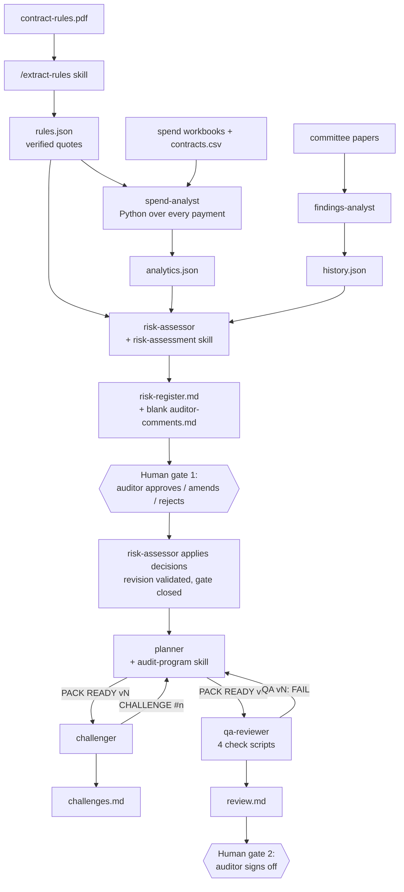

# Procurement Audit Planner: Skills, Agents and an Independent Harness

An implementation of the [Procurement Audit Planner build guide](https://procurement-audit-planner.vercel.app/)
with Claude Code's **Skills + Agents** architecture. Working from West Berkshire Council's
public data, it extracts the testable purchasing rules, analyses every payment, records past
audit history, rates the risks for a human auditor to approve, and turns the approved risks
into a cross-checked audit planning pack that the auditor signs off.

The system plans an audit; it does not perform one. Every output describes **risk indicators
to investigate**, never wrongdoing by the council, a service or a supplier.

## Submission

| Part | Deliverable | Status |
|---|---|---|
| A | GitHub repository with this README | All 27 guide items completed in Claude Code (see [confirmation](#guide-completion-confirmation)). Repository: https://github.com/gengtong0601-hub/Procurement-Audit-Planner-4 |
| B | Deployed independent harness | Implemented in `harness/`; not yet deployed (see [Part B](#part-b-independent-harness)). Deployed URL: _to be added_ |

---

## Skills

A skill is a packaged method: a `SKILL.md` that Claude follows, plus the Python script that
does every calculation and check. Skills live in `.claude/skills/`.

| Skill | Invoked by | Files | What it does | Run evidence |
|---|---|---|---|---|
| `extract-rules` | The human, as `/extract-rules` (guide 2.2) | `SKILL.md`, `verify_quotes.py` | Turns `data/contract-rules.pdf` into `outputs/rules.json`: one entry per testable rule (clause, page, type, thresholds as printed, approver, verbatim quote). It also records excluded clauses with reasons, null statutory-threshold parameters and document notes. The verifier checks the schema and that every quote is on its stated page. | [step 2.2](docs/claude-evidence/step-2.2/README.md) |
| `risk-assessment` | The `risk-assessor` agent (guide 3.5–3.7, 4.3) | `SKILL.md`, `build_register.py` | The rating method: a likelihood rubric, impact from the council's own descriptors, and a citation for every judgment (`[rule:]`, `[metric:]`, `[history:]`). The builder resolves every citation, fills every `{{$.path}}` figure from the analytics, scores from the council's 5×5 matrix and bands, writes `risk-register.md` and the blank `auditor-comments.md` template, and validates revisions after the auditor's decisions. | [step 3.5](docs/claude-evidence/step-3.5/README.md) |
| `audit-program` | The `planner` teammate (guide 5.3, 5.7) | `SKILL.md`, `build_pack.py` | Turns the approved risks into the pack: risk → expected control → test step → targeted sample, plus the PBC request list. The builder refuses to start while the gate is open, draws every sample, fills every figure and writes `planning-memo.md`, `risk-control-matrix.md`, `audit-program.md` and `samples/`. | [lesson 5](docs/claude-evidence/step-5/README.md) |

## Agents

Agents are defined in `.claude/agents/`. Each runs in its own context with its own tools and
owns specific output files. The three analysis sub-agents keep data-heavy work out of the main
conversation. The three team members check each other's work.

| Agent | Role | Reads | Owns (writes) | Run evidence |
|---|---|---|---|---|
| `spend-analyst` | Sub-agent (3.1–3.2). Writes and runs Python over the full spend population: cleaning, tagging, threshold clustering, split purchases, duplicates, high-value suppliers, notice coverage, expired-notice spend, spend vs award. Python computes every number. | `rules.json`, `data/spend/*.xlsx`, `data/contracts.csv` | `scripts/clean.py`, `analyse.py`, `selfcheck.py`; `outputs/analytics.json`, `outputs/analytics-full/` | [step 3.2](docs/claude-evidence/step-3.2/README.md) |
| `findings-analyst` | Sub-agent (3.3–3.4). Records past audit opinions, gaps, risk themes and the council's risk-scoring method from the committee papers. It records and never scores. | `data/committee/*.pdf` | `outputs/history.json` (checked by `scripts/verify_history.py`) | [step 3.4](docs/claude-evidence/step-3.4/README.md) |
| `risk-assessor` | Sub-agent (3.6–3.7, 4.3). Follows the risk-assessment skill to rate risks and, after the human gate, applies the auditor's decisions as a validated revision. | `rules.json`, `analytics.json`, `history.json`, `auditor-comments.md` | `outputs/risk-ratings.json`, `risk-register.md`, `auditor-comments.md` template, `risk-baseline.json`, `gate-evidence.json` | [step 3.7](docs/claude-evidence/step-3.7/README.md), [4.3](docs/claude-evidence/step-4.3/README.md) |
| `planner` | Team member (5.4). Follows the audit-program skill. Answers challenges and QA failures by revising the plan and announcing `PACK READY vN`. | approved register, rules, analytics | `outputs/audit-plan.json` and the pack it renders | [lesson 5](docs/claude-evidence/step-5/README.md) |
| `challenger` | Team member (5.5). Finds where the plan is weaker than the evidence and makes the planner answer, for at most two rounds. | register, analytics, history, pack | `outputs/challenges.md` | [lesson 5](docs/claude-evidence/step-5/README.md) |
| `qa-reviewer` | Team member (5.6). Runs the four check scripts on every pack version and blocks sign-off until all pass. | pack, `scripts/checks/*.py` | `outputs/review.md` (sign-off block left for the auditor) | [lesson 5](docs/claude-evidence/step-5/README.md) |

Each agent has project memory (`.claude/agent-memory/<agent>/`, gitignored) for **method lessons
only**, never figures, findings or supplier names. Every memory written in this run was checked
against that rule.

## How they work together



1. **Files are the interface.** Each stage writes a file the next stage reads, so every
   hand-off can be inspected and re-run.
2. **The model judges; Python computes.** Agents read and decide (which clause is testable,
   how likely a risk is, which control to test). Scripts do every count, sum, score, sample
   and check. No agent types a figure: prose uses `{{$.path}}` placeholders that the builders fill.
3. **Everything is traceable.** Rule quotes are verified against the PDF page, every rating cites
   a rule, metric or audit item, and every sampled payment carries its workbook row ID.
4. **Two human gates.** The planner cannot start until `build_pack.py --gate` confirms that every
   risk has an auditor decision and that the risk-assessor applied them as a validated revision.
   The decisions and register are bound by hashes in `gate-evidence.json`. Only the auditor signs
   `review.md`.
5. **Challenge and QA before sign-off.** The challenger and qa-reviewer work on each pack
   version until the challenges are closed and all four checks pass: quotes, numbers, traceability, samples.

## Guide completion confirmation

All 27 checklist items (2 prerequisites and 25 numbered steps) were completed in Claude Code
on **2026-10-15**. The project had first been prepared with Codex by a teammate (baseline
commit `caebffd`), and every guide step was then run natively in Claude Code. The skill and
agent definitions match the guide's published files except for quoting four YAML
descriptions (`docs/IMPLEMENTATION_NOTES.md`). Each row links to the evidence saved at the time.

| Guide step | Done in Claude Code | Evidence | Commit |
|---|---|---|---|
| Prerequisites, 1.1–1.5 Setup | Brief loaded; data re-verified (9/9 hashes); `.venv` built; skills and agents discovered | [setup](docs/claude-evidence/setup/README.md) | `caebffd`, `436c77a` |
| 2.1 Build extract-rules | Skill and verifier checked; verifier made robust to both PDF extractors, with regression tests | [setup](docs/claude-evidence/setup/README.md), [2.2](docs/claude-evidence/step-2.2/README.md) | `436c77a` |
| 2.2 Run `/extract-rules` | 82 rules, 85 exclusions, 4 null parameters, 16 notes; quotes verified; 3 spot-checks against rendered pages | [2.2](docs/claude-evidence/step-2.2/README.md) | `cc4cc35` |
| 3.1–3.2 spend-analyst | Agent identical to the guide's; ran as a sub-agent; independent openpyxl reconciliation of every flagged row (0 failures) | [3.2](docs/claude-evidence/step-3.2/README.md) | `aba4a46` |
| 3.3–3.4 findings-analyst | Ran as a sub-agent; 172 sourced items, all quoted; 4 items spot-checked against rendered pages; a duplicate-ID defect sent back and fixed | [3.4](docs/claude-evidence/step-3.4/README.md) | `b825836` |
| 3.5 risk-assessment skill | Checked against the guide's requirements; builder fixed to read the council matrix and bands, cite scale entries, and state the threshold choice in the header; good/broken fixture test | [3.5](docs/claude-evidence/step-3.5/README.md) | `b6fbe63` |
| 3.6–3.7 risk-assessor | Ran as a sub-agent: 9 risks, 0 failures, 0 warnings; builder rerun byte-identical; supplier-name check | [3.7](docs/claude-evidence/step-3.7/README.md) | `38176bf` |
| 4.1 Decision template | Template shown beside the register; 9/9 blank, counted with the builder's parser | [4.1](docs/claude-evidence/step-4.1/side-by-side.md) | `c31b122` |
| 4.2 Record decisions | Auditor (Tony) approved all nine: R-02–R-08 in scope, R-01 and R-09 accepted as out of scope | [4.2](docs/claude-evidence/step-4.2/README.md) | `7a61390` |
| 4.3 Revise the register | risk-assessor applied the decisions as revision 1; gate closed (exit 0) | [4.3](docs/claude-evidence/step-4.3/README.md) | `e6badc4` |
| 5.1 Close the gate | Gate check: revision 1, 9 decisions, 7 in scope | [5.1](docs/claude-evidence/step-5/5.1-gate.txt) | `371155a` |
| 5.2 Enable agent teams | `CLAUDE_CODE_EXPERIMENTAL_AGENT_TEAMS=1` in `.claude/settings.json` and in the session environment | [lesson 5](docs/claude-evidence/step-5/README.md) | `371155a` |
| 5.3–5.6 Skill, planner, challenger, qa-reviewer and checks | Compared with the guide's files: agents and skill identical (YAML quoting only); builder and checks carry documented hardening | [lesson 5](docs/claude-evidence/step-5/README.md) | `371155a` |
| 5.7 Run the team | **Lead-relayed** (see below): 3 pack versions, 12 challenges (10 resolved, 2 for the auditor), QA READY FOR SIGN-OFF 4/4 | [lesson 5](docs/claude-evidence/step-5/README.md), [relay log](docs/claude-evidence/step-5/relay-log.md) | `371155a` |
| 5.8 Sign off | Auditor's own sign-off recorded at their request: Tony, 2026-10-15, "sign off" | [lesson 5](docs/claude-evidence/step-5/README.md#58-sign-off) | `a4d5c33` |

### Where the run differed from the guide

- **Lesson 5 messaging was relayed by the main session, not native agent-team messaging.**
  Agent teams were enabled, but in the Claude Code desktop app's Code tab the spawned agents had
  no SendMessage tool, so teammates could not message each other. All three reported this
  instead of simulating a teammate (attempt 1). At the auditor's choice, the main session then
  forwarded every teammate message verbatim: 14 logged, 1 withheld with its reason, none edited.
  Each teammate still worked in its own context on its own files and made its own judgments.
  Running the guide's 5.7 prompt in the Claude Code CLI would give native teammate messaging.
- **Claude Code desktop app instead of VS Code + CLI.** The same project, skills and agents
  were used; the CLI is not installed on this machine.
- **Fixes made along the way** (each with its own evidence): quote verification that is robust
  to the PDF extractor, and portable hash records (`436c77a`); the step 3.5 builder reading the
  council matrix produced in 3.4; a duplicate-ID defect in `history.json` fixed by the
  findings-analyst; a stale blank decision template removed before 3.7; and, before any
  decision, the payee name "Ofsted" in one justification replaced with "an inspectorate".

## Results: the signed-off planning pack

- **Rules:** 82 testable rules, 85 exclusions with reasons, and 4 statutory thresholds left null
  for the auditor, because the PDF only names them.
- **Spend:** 10,607 payments (May–July 2026), 8,534 after logged exclusions. Every flagged item
  has a workbook row ID.
- **History:** 20 audits with opinions, 12 risk themes, the council's 5×5 scoring method, 8 gaps
  (including the confidential Corporate Risk Register) and 15 recorded discrepancies.
- **Register:** 9 risks. The auditor approved all; 7 are in scope, R-02 (score 9) and R-03 (12) highest.
- **Pack v3:** `outputs/planning-memo.md`, `risk-control-matrix.md` and `audit-program.md`, with
  11 controls, 15 tests, 172 sampled transactions in `outputs/samples/` and 24 PBC requests;
  36 of 82 rules tested, the rest listed with reasons.
- **Review:** `outputs/review.md` reports 4/4 checks passed and is signed off by the auditor.
  Two points were recorded for the auditor in `outputs/challenges.md`: placement-spend scope and
  the R-08 likelihood rating.

## Reproduce

Python 3.11+ (3.13 used). Poppler is optional: the quote verifiers also use pypdf.

```bash
python3 -m venv .venv
.venv/bin/python -m pip install -r requirements.txt
```

```bash
.venv/bin/python .claude/skills/extract-rules/verify_quotes.py outputs/rules.json data/contract-rules.pdf
.venv/bin/python scripts/verify_history.py outputs/history.json data/committee
.venv/bin/python scripts/selfcheck.py
.venv/bin/python .claude/skills/risk-assessment/build_register.py outputs/risk-ratings.json
.venv/bin/python .claude/skills/audit-program/build_pack.py --gate
.venv/bin/python scripts/checks/run_checks.py
.venv/bin/python -m pytest -q --basetemp runtime/test-temp
```

The builders are deterministic: rerunning them leaves the outputs byte-identical. The test suite
has 48 tests, of which 47 pass. The one failure is a Part B harness test, described below.

## Part B: independent harness

`harness/` is a Flask web application that runs the same workflow without Claude Code. Python
builds and validates every output; an optional Claude Messages API provider supplies the
agent judgments in live mode. Reviewer decisions and sign-off come only from the person using
it. See [docs/DEPLOYMENT.md](docs/DEPLOYMENT.md) for running, deploying and the smoke test.

Status: implemented and runnable locally, **not yet deployed**. One harness test currently fails
in the prepared-evidence mode, for two known reasons that are being fixed:

1. It copies the now-revised `risk-ratings.json` (with its revision block) into a fresh run that
   has no decisions.
2. Its demo plan assumes every risk cites a rule, but R-04 legitimately does not.

The deployed URL will be added above once the hosted end-to-end run passes.

## Repository layout

```text
CLAUDE.md                 project brief Claude Code reads every session
.claude/skills/           extract-rules, risk-assessment, audit-program (SKILL.md + script)
.claude/agents/           spend-analyst, findings-analyst, risk-assessor, planner, challenger, qa-reviewer
.claude/settings.json     enables agent teams
data/                     immutable public inputs + SHA-256 manifest
scripts/                  cleaning, analysis, self-check, history verifier
scripts/checks/           the four QA checks and their runner
outputs/                  rules, analytics, history, register, decisions, pack, challenges, review
harness/                  Part B web harness
tests/                    data, gate, quote and harness tests
docs/claude-evidence/     per-step evidence from the Claude Code run
docs/                     sources, extraction notes, implementation notes, deployment
```

## Data, limits and attribution

All inputs are public West Berkshire Council and Contracts Finder data. Sources are in
[docs/SOURCES.md](docs/SOURCES.md) and hashes in `data/manifest.json`. Contracts Finder notices
are not a complete contract register; near matches are candidates, not matches; annualised figures are
estimates; payment-run dates are not invoice dates. No indicator proves a breach. Guide-derived
code and local changes are attributed in [docs/IMPLEMENTATION_NOTES.md](docs/IMPLEMENTATION_NOTES.md).
No licence is asserted over the course materials.
